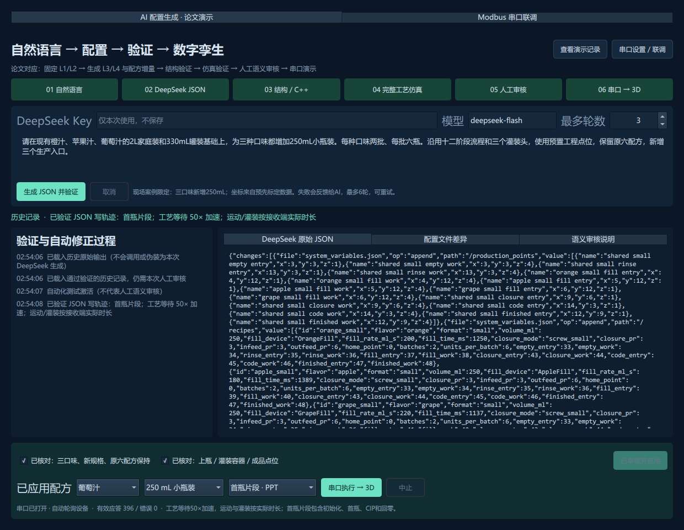
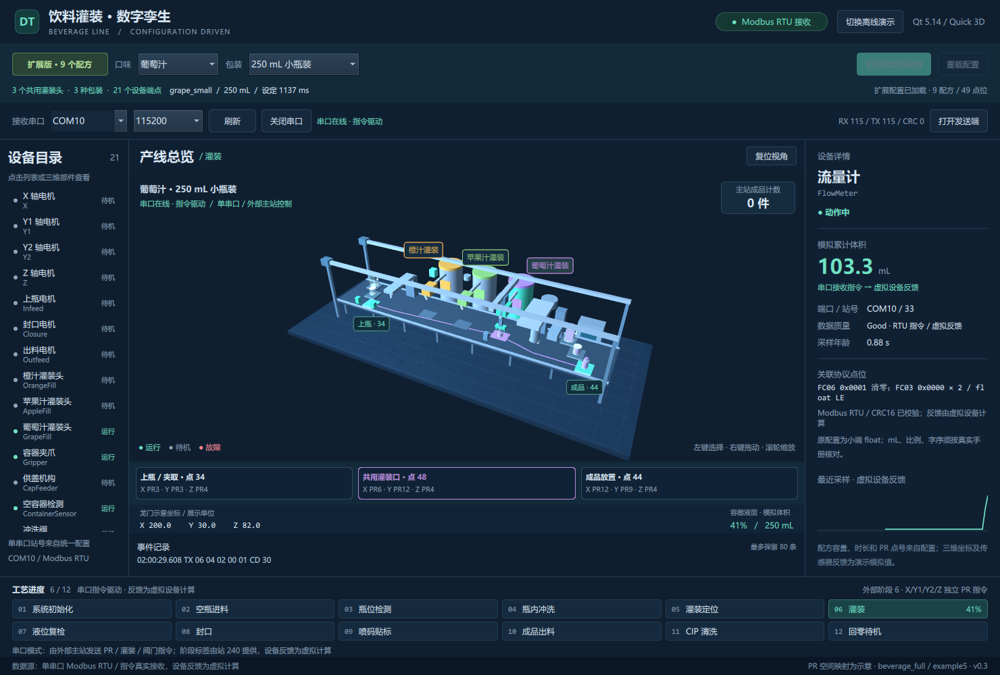

# 饮料灌装数字孪生演示版 v0.4

v0.4加入 **真实 DeepSeek API → JSON增量 → 原仓库C++检查 → 完整工艺仿真 → 失败反馈与修正 → 人工语义审核 → 应用候选 → 串口驱动3D**。双击 `run_ai_demo.bat`，发送COM3、接收COM10；在发送端输入Key，使用默认自然语言需求开始演示。Key不保存。

本版AI案例限定为**三种口味同时增加250mL小瓶装**。每轮原始输出、差异、错误、实际模型与验证报告均保留；九个正常配方和十一个预设故障全部通过后才能审核应用。串口端为已验证写轨迹回放，PPT首瓶片段和50倍工艺等待加速明确标注；未实现原引擎的在线条件解释。完整操作、边界和测试见 [DeepSeek论文演示说明](docs/DEEPSEEK_DEMO.md)。



可运行的 **C++ / Qt 5.14.0 / QML / Qt Quick 3D** 桌面程序。以原项目 `beverage_full` 案例的 JSON 配置驱动配方、容量、生产点、工艺层级和设备目录：原配置为 **三口味 × 两规格，共 6 个配方**；扩展配置为三种口味同时新增 250 mL 小瓶装，共 **9 个配方**。

三种口味分别使用固定的橙汁、苹果汁、葡萄汁灌装头。同一口味的各规格共用灌装头；切换规格时容器外形、上瓶和成品位置、灌装定位的 Y/Z PR、封口模式及其他生产点随配置变化。三维布局与 PR 到场景坐标的映射为演示标定。



v0.3 增加 **单串口 Modbus RTU 从站**和独立的 Qt 指令发送窗口。默认接收 **COM10**、发送 **COM3**，115200 / 8N1，串口号与波特率可在界面修改。动作由有效串口指令驱动，设备反馈由虚拟模型计算。

双击 **`run_serial_test.bat`** 打开两个程序，再在发送端点击“发送单件工艺”。完整地址表、接线、原配置引擎导出方法及测试命令见 [串口联调说明](docs/SERIAL_PROTOCOL.md)。


这是独立的数字孪生演示工程。生产线配置来源于 [industrial_config_engine](https://github.com/MingChuQing/industrial_config_engine) 的案例快照；本版在 `ai/` 收录所需原引擎与验证器，注明来源、提交和冻结输入哈希。论文资料仍由原项目管理。

## 直接运行

首次从 GitHub 克隆源码后，先按下方“构建”章节编译并打包，生成 `dist` 运行目录。

串口联调使用 `run_serial_test.bat`；也可以分别运行 `run_receiver.bat` 与 `run_sender.bat`，选择端口并打开。直接运行 `dist/BeverageTwinDemo.exe` 进入串口接收模式。离线演示使用 `run_demo.bat`。保留整个 `dist` 文件夹，其中包含 Qt / MinGW DLL、QML 插件、Python标准库运行时、原引擎探针和外部 JSON 配置。离线与串口回放无需联网，DeepSeek生成需要联网。

`run_demo.bat` 自动开始离线演示；串口模式等待外部主站命令。截图中的 Qt Creator 4.13.1 是 IDE 版本；本机实际使用的构建 Kit 为 Qt 5.14.0 / MinGW 7.3 / 64 位。

## 离线配置演示顺序

1. 选择原版配置，依次选择橙汁、苹果汁、葡萄汁，确认每种口味只有 **2 L 家庭装、330 mL 罐装** 两个选项。场景中的三个口味灌装头始终保留。
2. 在同一口味下切换家庭装与罐装，查看容器形状、上瓶 / 灌装 / 成品点卡片，以及 X/Y/Z PR 的变化。
3. 切到扩展配置，配方数量变为 **9**，三种口味均出现 **250 mL 小瓶装**。选中新增规格后，上瓶工作点为 **34**，成品工作点为 **44**。
4. 分别选择三种口味的小瓶装：共用的三个灌装头仍对应原设备 ID，灌装工作点分别为 **38 / 46 / 48**；容量读取为 250 mL。
5. 开始演示。每个配方按源配置生产 **2 批 × 6 个容器**，之后执行一次 CIP，再回零待机。可提高速度或点击工艺步骤做局部预览。
6. 修改运行目录下的 JSON 后使用重新加载配置功能。界面显示正在读取的配置目录和加载结果；无效配置会被拒绝，保留当前有效配置。

切换配置或配方会重置当前模拟过程。步骤跳转属于预览，不增加产量。循环选项在整份配方的 12 个容器、CIP 和回零结束后重新开始。

## 离线操作

- **开始 / 继续、暂停、推进一步、重置**控制模拟过程；暂停保留机械位置，并关闭模拟动作输出。
- **0.5× / 1× / 2× / 4×**改变演示速度。短时灌装在画面中至少展示 3 秒，设定灌装时长仍显示源配方数值。
- 点击左侧设备目录或三维设备，查看状态、原配置端口 / 站号、示例协议点位、采样质量与趋势。
- **右键拖动**旋转视角，滚轮缩放，复位视角恢复初始相机。
- 故障演示包括流量计离线、Y2 驱动器报警和容器到位超时。注入后暂停并选中异常设备；离线保留最后有效值，当前采样无效，趋势中断。清除故障后保持暂停，点击继续恢复。

## 配置来源与结构

原始资料是本地 Git 项目 `industrial_config_engine` 的 `examples/beverage_full/example4` 和 `example5`；读取时提交为 `00f0f1f`。演示工程另存配置快照，不修改原项目。

| 内容 | 原版 baseline | 扩展版 extended |
|---|---:|---:|
| 口味 | 橙汁、苹果汁、葡萄汁 | 相同 |
| 包装 | 2 L 家庭装、330 mL 罐装 | 增加 250 mL 小瓶装 |
| 配方 | 6 | 9 |
| 生产点 | 33 | 49 |
| 设备端点 | 21 | 21 |
| 每配方产量 | 2 批 × 6 个 | 2 批 × 6 个 |

- `config/recipes/baseline/`、`extended/`：原样保存两份注册表、系统变量及分层工艺 JSON，共 63 个源 JSON 文件。加载器依据 `recipe_lookup[flavor][specification]` 选择配方，并核对 L4 的两参数调用与 L3 参数范围。
- `config/source_manifest.json`：导入源路径和文件 SHA-256，方便核对快照。`tools/import_recipe_profiles.py` 可从本地原项目重新导入。
- `config/demo_profile.json`：演示新增的中文标签、设备显示信息、步骤活动关联及非灌装步骤的展示时长。
- `config/serial/`：单串口设备注册表、串口默认值、类型化寄存器 / 线圈映射及新增站 240 管理接口。收发程序共用该配置。
- `config/visualization.json`：口味颜色、包装外形和 PR 到三维坐标的示意映射。这里的坐标不代表实机毫米位置。

扩展版保留原 6 个配方、原 33 个点位和设备注册表，再追加新数据。程序加载时校验这些约束。`OrangeFill`、`AppleFill`、`GrapeFill` 在两份注册表中保持不变；原快照端口为 `SIM_MOTION` / `SIM_PROCESS`。串口模式使用新增的 `config/serial/device_registry.json` 统一站号表：运动 1–7、工艺 21–34；单个接收串口响应全部虚拟设备。

| 包装 | 上瓶工作点 | 橙汁 / 苹果汁 / 葡萄汁灌装工作点 | 成品工作点 | 封口模式 |
|---|---:|---|---:|---|
| 2 L 家庭装 | 2 | 6 / 26 / 30 | 12 | 大瓶旋盖 |
| 330 mL 罐装 | 14 | 18 / 28 / 32 | 24 | 卷封 |
| 250 mL 小瓶装 | 34 | 38 / 46 / 48 | 44 | 小瓶旋盖 |

例如橙汁三种规格的灌装 X PR 均为 4，Y/Z PR 分别为 `(10,2)`、`(11,3)`、`(12,4)`。共用灌装头与容器采用不同定位点可以同时成立。

程序优先读取 EXE 旁的 `config`；开发目录构建时读取项目 `config`；缺少外部配置目录时才使用 QRC 内置副本。打包的外部 JSON 可编辑后重新加载，无需编译。重新打包会从项目 `config` 更新 `dist/config`，请把要保留的配置修改同步回项目目录。

## 构建

用 Qt Creator 打开 `beverage_twin_demo.pro`，选择 **Qt 5.14.0 / MinGW 7.3 / 64 位** Kit。若需要添加 Qt 版本，选择：

`D:/Qt/Qt5.14.0/5.14.0/mingw73_64/bin/qmake.exe`

编译器选择 `D:/Qt/Qt5.14.0/Tools/mingw730_64/bin/g++.exe`。本机已安装 Qt Quick 3D。PowerShell 构建并打包：

```powershell
.\build_demo.ps1 -Deploy
```

其他安装路径可传入 `-QtRoot`、`-MinGWBin`。修改 C++ / QML 或内置资源需要重新编译；工程包含递归 JSON 资源依赖以兼容中文工作目录。Qt Quick 3D 在 Qt 5.14 中为技术预览模块，此版针对上述本机工具链验证。

## 验证与实现入口

```powershell
.\dist\BeverageTwinDemo.exe --self-test
python .\tools\verify_demo.py --gui
python .\tools\verify_demo.py --gui --small
python .\tools\verify_demo.py --gui --profile extended --flavor 1 --format 1
```

后端测试覆盖 6 → 9 配方、共用灌装头、原点位保留、九个配方的 12 容器批次、故障恢复和预览不计产量。GUI 测试运行实际 QML / 三维场景，验证拾取、开始操作及离线恢复，并保存原版、扩展版的运行 / 故障截图。`--small` 使用 1120 × 840 窗口。测试脚本清除 Qt 路径环境，验证 `dist` 自带运行库；报告为 `verification.json` / `verification-small.json`。

也可直接传入 `--extended --flavor N --format N` 启动指定配方：口味 0/1/2 为橙汁 / 苹果汁 / 葡萄汁，规格 0/1/2 为家庭装 / 罐装 / 小瓶装。规格 2 需要扩展配置。

- `src/twincontroller.*`：配置加载与校验、配方选择、状态模型、模拟工艺、数据质量及趋势。
- `qml/Main.qml`：版本 / 配方选择、运行控制、设备详情、点位和十二步工艺。
- `qml/LineScene.qml`：三个固定灌装头、规格工位、运动与容器显示。
- `src/serialplant.*`：单串口多站号 RTU 从站、CRC / 分包校验、命令驱动的虚拟设备与通信质量。
- `src/serialmaster.*`、`qml/Sender.qml`：独立主站程序、单件联调工艺、手动命令与应答匹配。
- `src/aicontroller.*`、`qml/AiPanel.qml`、`ai/pipeline.py`：真实DeepSeek调用、逐轮验证/修正、人工审核、原子激活、候选轨迹回放。
- `ai/engine/`、`ai/vendor/`、`ai/provenance.json`：原引擎与验证器、来源提交、冻结工程输入。
- `tools/verify_serial.py`：协议回归及 COM10 / COM3 双进程 GUI 实测。
- `tools/export_single_bus_case.py`：为原配置引擎导出共用站号的单总线案例。
- `tools/deploy_runtime.ps1`：复制 Qt / QML 插件及 PE 依赖形成可移动运行目录。

串口模式已接入真实串口 / Modbus RTU，虚拟设备接收命令、计算动作和传感器状态并回传应答。当前不是物理设备采集器；原引擎完整 L1/L2 仍由外部控制程序执行，离线模式保留原模拟工艺。Qt / MinGW 动态运行库许可保留在 `dist/licenses`。

2026-10-18实测：真实DeepSeek会话一轮通过9配方/11预置故障检查；随后两个原生Qt窗口在COM3/COM10完成首瓶片段，396次有效应答、CRC错误0、出料1件并回零。AI本次采用的灌装点42、成品点48也已同步到接收端卡片。审核控件的自动化测试明确标记`TEST_ONLY`。详见[无密钥实测记录](docs/evidence/v04-verification.json)和[原始API输出](docs/evidence/deepseek-live/raw_response.json)；这不是生成成功率统计。

本项目采用GPL-3.0-or-later，见[LICENSE](LICENSE)；nlohmann/json保留MIT许可，Python和Qt运行库保留各自许可。
